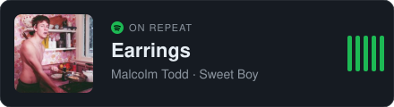

# Hi, I'm Naenon! 👋

**Saroot Areerattanawetch** — QA Engineer | Full-stack Developer

## 🚀 About Me
Computer Engineering student with hands-on experience in both quality assurance and web development. Proficient in manual, automated, API, and performance testing, and in building end-to-end web applications with Next.js, React, and Spring Boot (Java/Kotlin). Combines a developer's understanding of how systems are built with a tester's attention to edge cases, accessibility, and reliability — delivering software that is well-tested, maintainable, and user-friendly.

## 🔗 Links

## 💼 Experience

### Quality Assurance Engineer
**ANYVET Co., Ltd.** · *Aug 2026 – Present*
- Designed and executed test cases covering functional, regression, and integration scenarios for web applications.
- Built and maintained automated browser test scripts for user flows and regression, reducing repetitive effort and speeding up release verification.
- Verified UI behaviour, form validation, rendering states, and API behaviour against design and functional specifications.
- Worked with developers to reproduce, debug, and verify defects across frontend and backend layers, and maintained up-to-date QA documentation.

### Software Tester (Intern)
**Ayodia Co., Ltd.** · *May 2026 – Jul 2026*
- Executed manual functional, regression, and integration tests for web applications end to end.
- Performed API testing with Postman, verifying backend responses against expected contracts and how the frontend handled loading, empty, and error states.
- Tracked defects, verified fixes, and collaborated with developers to ensure product quality, while maintaining QA documentation.

### Full-stack Developer (Intern & Freelance)
**Smart Shift Solutions** · *May 2025 – Apr 2026*
- Built an end-to-end CRM system with a Next.js frontend and Kotlin Spring Boot backend, covering UI, REST APIs, and database layer to improve client workflow efficiency.
- Implemented client-facing screens and workflows, integrating REST APIs and handling client-side state, routing, and data rendering.
- Researched and applied AI/Automation solutions to improve product features and system optimization.
- Delivered features across a year-long engagement, moving from internship to freelance contributor.

### Software Developer (Intern)
**National ITMX** · *May 2024 – Jul 2024*
- Collaborated on high-scale web application development using Next.js and Java Spring Boot.
- Developed and executed test cases and test plans for web applications, documented bugs, and verified fixes before deployment.

## 👨🏼‍💻 Education

<table>
<tr>
<td width="50%" valign="top">
<h3>🎓 Chulalongkorn University</h3>
B.Eng. in Computer Engineering and Digital Technology (CEDT) 
Aug 2023 – Expected 2026 · GPAX 3.15
</td>
<td width="50%" valign="top">
<h3>🏫 Princess Chulabhorn Science High School Phitsanulok</h3>
Sciences and Mathematics Program 
May 2017 – Mar 2023 · GPAX 3.58
</td>
</tr>
</table>

## 🛠 Skills

**Testing & Automation**

**AI**

**Design & IoT**

| Area | Skills |
|---|---|
| **Frontend** | Next.js, React, JavaScript, HTML, CSS, Responsive Layouts, Component-based UI |
| **Backend** | Java Spring Boot, Kotlin Spring Boot, Golang, Python, REST API Design & Integration |
| **Database & Infrastructure** | SQL, PostgreSQL, MongoDB, Supabase, Docker, Git, GitHub, GitLab |
| **Testing** | Manual Testing, Test Case Design, Test Planning, Functional, Integration, Regression, API, Performance, Cross-browser & Accessibility Testing, Bug Tracking |
| **Automation & Testing Tools** | Playwright (E2E), k6, Robot Framework, Postman, Jira / Trello / ClickUp |
| **AI** | Claude Code, Prompt Engineering, AI-assisted Test Design & Automation, MCP (Model Context Protocol), Custom AI Agent Skills |
| **Process** | Agile/Scrum, SDLC, STLC, Defect Life Cycle, Code Review, Test & Technical Documentation |
| **UX/UI Design** | Figma, Canva |
| **IoT / Microcontroller** | Arduino, ESP32, Raspberry Pi, Sensors, IoT Dashboard, Streamlit, MQTT |

## 🏆 Competitive & Academic Achievements

<table>
<tr>
<td width="50%" valign="top">
<h3>🛡️ Human Trafficking Case Reporting System</h3>

Built and tested a secure web-based reporting platform — from the web interface to backend workflows — covering anonymous report submission, data dashboards, role-based access and views, AI case matching, and performance validation.

</td>
<td width="50%" valign="top">
<h3>📊 BPF-Best</h3>

Developed and validated a fund comparison platform with filtering, search, and side-by-side data views, verifying data mapping, calculation accuracy, edge cases, and overall user workflow reliability.

</td>
</tr>
<tr>
<td width="50%" valign="top">
<h3>👓 New Vision</h3>

Designed and validated assistive glasses for the blind with a user-centered approach, covering user requirements, interaction design, functional reliability, and accessibility testing.

</td>
<td width="50%" valign="top">
<h3>⚙️ Predictive Maintenance Prototype</h3>

Built and tested a predictive maintenance prototype, validating hardware–software integration and analysing machine sound data to present readable industrial insights.

</td>
</tr>
<tr>
<td colspan="2" valign="top">
<h3>♻️ Community Waste Management System</h3>

Hackathon to solve community problems — designed a community waste management system.

</td>
</tr>
</table>

## 📈 GitHub Stats

## 🎧 On Repeat

More details and screenshots at <a href="https://stormnoopper.netlify.app/">stormnoopper.netlify.app</a>

